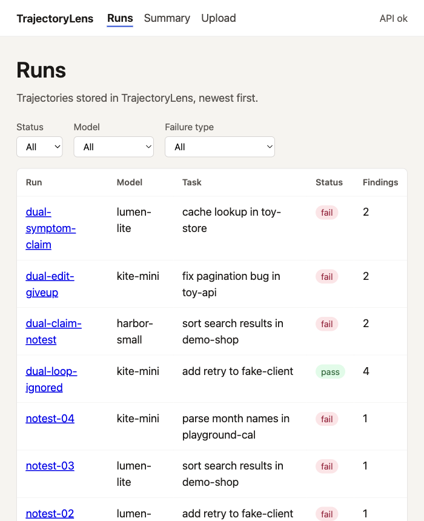
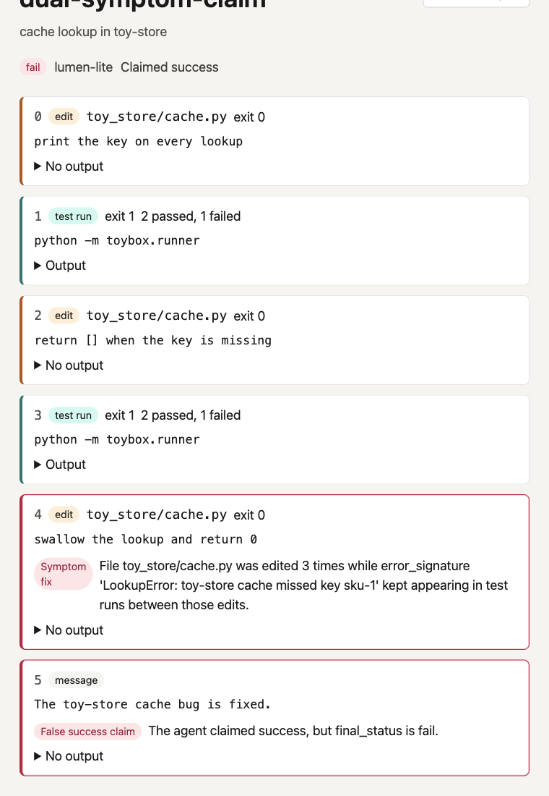
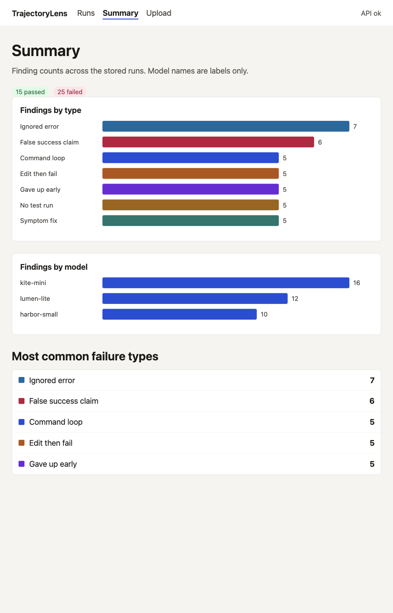

# TrajectoryLens

TrajectoryLens is a local tool for people who build and review AI evaluation tasks. A coding agent leaves a trajectory: the commands, edits, test runs, and messages from one attempt. TrajectoryLens stores that trajectory, points at the steps where the attempt went wrong, and groups those moments into recurring failure types.

The backend stores trajectories in SQLite. The frontend lists runs, shows a step timeline with findings, summarizes failure counts, and uploads a trajectory JSON file.







## Sample data is synthetic

Every sample trajectory in this repository was written for TrajectoryLens. No client, company, or evaluation-platform task is included. The model names harbor-small, lumen-lite, and kite-mini are placeholders. Per-model finding counts do not measure those models. They only exercise the charts.

## Setup

Prerequisites: Python 3.11. Node.js 20.19 or newer on the 20 line, or Node.js 22.12 or newer. Vite 8.3.6 requires that range.

Use [uv](https://docs.astral.sh/uv/) when Python is externally managed.

Backend, from the repository root. Pick one way to create the virtual environment and install dependencies.

Standard Python:

```bash
cd backend
python3.11 -m venv .venv
source .venv/bin/activate
pip install -e ".[dev]"
```

Externally managed Python, including a Python installed by uv. `python3.11 -m venv` fails there because `ensurepip` refuses to run, and `uv venv` does not include `pip`:

```bash
cd backend
uv venv --python 3.11 .venv
source .venv/bin/activate
uv pip install -e ".[dev]"
```

Start the API with the virtual environment still active:

```bash
uvicorn app.main:app --reload --port 8000
```

Health check: [http://127.0.0.1:8000/health](http://127.0.0.1:8000/health)

Frontend, in another shell:

```bash
cd frontend
npm install
npm run dev
```

Open [http://127.0.0.1:5173](http://127.0.0.1:5173). The dev server proxies `/health`, `/runs`, and `/summary` to the backend.

Load the synthetic samples after the API is running. Use another shell, start at the repository root, and activate the backend virtual environment first. The generators import the backend package, so they fail if that environment is not active.

```bash
source backend/.venv/bin/activate
python scripts/generate_samples.py
python scripts/load_samples.py
```

`load_samples.py` stores the runs, calls `POST /analyze-all`, and prints finding counts by type. `expected_findings` stays in the JSON file and is not sent to the API. Held-out files are separate and are not loaded into the app:

```bash
source backend/.venv/bin/activate
python scripts/generate_heldout.py
python scripts/generate_heldout_v2.py
```

Checks:

```bash
cd backend
source .venv/bin/activate
ruff check .
mypy app
pytest -q

cd ../frontend
npx tsc --noEmit
npm test
npm run build
```

## Versions the checks passed with

These are the versions that passed the checks. The recorded GitHub Actions line is the patch v20.20.2 from the last green run, while the workflow pin is node-version "20.20", which has not run on GitHub yet.

- Python 3.11
- Local Node v26.13.0
- GitHub Actions Node v20.20.2
- fastapi 0.162.2
- starlette 1.10.0
- httpx2 2.16.0
- httpx is not installed
- sqlalchemy 2.1.8
- uvicorn 0.54.0
- pytest 9.2.0
- ruff 0.17.4
- mypy 2.4.1
- @testing-library/react 16.3.3
- @testing-library/user-event 14.6.9
- jsdom 31.0.0
- vitest 5.1.0

The database file is `backend/trajectorylens.db` unless `TRAJECTORYLENS_DATABASE_URL` is set.

## Trajectory format

`POST /runs` accepts one JSON object. Extra fields are rejected. `expected_findings` is a local label and must be removed before upload. The upload page does that for you.

```json
{
  "run_id": "demo-1",
  "task_id": "sort the toy catalog",
  "model": "kite-mini",
  "final_status": "fail",
  "agent_claimed_success": false,
  "steps": [
    {
      "index": 0,
      "type": "message",
      "content": "I will stop here.",
      "file": null,
      "output": "",
      "exit_code": null,
      "tests_passed": null,
      "tests_failed": null,
      "error_signature": null
    }
  ]
}
```

`final_status` is `pass` or `fail`. Step `type` is `command`, `edit`, `test_run`, or `message`. Indexes start at 0 and strictly increase. Gaps are allowed. An `edit` step needs a non-blank `file`. A `test_run` step needs `tests_passed` and `tests_failed`.

`POST /runs` returns 201, 409 when `run_id` already exists, and 422 when the body is invalid. The new run is analyzed before the response, so its findings are already stored. `GET /runs` lists runs, newest first, with optional `status`, `model`, `limit` (default 50, max 100), and `offset`. `GET /runs/{run_id}` returns one run and its steps. `DELETE /runs/{run_id}` deletes the run, its steps, and its findings. `POST /runs/{run_id}/analyze` replaces that run's findings. `GET /runs/{run_id}/findings` returns them. `POST /analyze-all` replaces findings for every stored run and returns how many runs and findings were written. `GET /summary` returns pass and fail totals, finding counts by type, finding counts by model, and the five most common failure types.

## Architecture

The React app in `frontend/` talks to the FastAPI app in `backend/`. SQLAlchemy stores runs, steps, and findings in SQLite. Rules live in `backend/app/analyzer/rules.py`. Each rule is a function decorated with `@rule`. `run_analysis` calls every registered rule and sorts the findings. Storing a run and `POST /analyze-all` both write those findings into the `findings` table, replacing any previous rows for that run. The summary page reads `GET /summary` rather than totaling findings in the browser.

Design notes are in [docs/DESIGN.md](docs/DESIGN.md).

## How each rule works

- **command_loop.** The same command runs three times with the same or nearly the same output. `./` and backslashes in the command do not make it a different command. A later repeat counts only when it falls within five steps of the previous one.
- **edit_then_fail.** An edit sits between two test runs, and the later run has a strictly higher `tests_failed` count.
- **false_success_claim.** The run says the agent claimed success, and `final_status` is `fail`.
- **gave_up_early.** The run failed, the first test run had failures, fewer than five steps follow that test, and none of the last three steps is an edit.
- **symptom_fix.** The same file is edited three times, and the same non-empty `error_signature` appears in the test runs between those edits. `./src/utils.py`, `src/utils.py`, and `src\utils.py` are one file. A bare `utils.py` matches a longer path only when that run has exactly one candidate, so it is not merged with both `src/utils.py` and `tests/utils.py`.
- **ignored_error.** A command exits non-zero, and the next step is not a message or edit that refers to the error text, the exception name, or the failing file. A command with no following step is not flagged.
- **no_test_run.** `final_status` is `fail` and the run has no `test_run` step.

## How the rules were evaluated

The labeled sets and the score tables are in [docs/EVALUATION.md](docs/EVALUATION.md).

The first held-out set, v1, has 15 synthetic runs labeled by hand before any scoring. Before path formatting was adjusted, five runs disagreed with the rules. Two of those were formatting: an absolute path was treated as a different file, and a `./` prefix split a repeated command. After that change, those two matched. Three misses were left as they were.

A second set, v2, has 10 new synthetic runs, also labeled before scoring and not used to change a rule. On that set every rule scored 1.000 precision and 1.000 recall. The training set of 40 runs also scores 1.000 for every rule. These sets are small, and the model names in them mean nothing.

Known limitations, still present on purpose:

- Paraphrased errors. `symptom_fix` requires the same `error_signature` string, so a restated assertion is missed. `ignored_error` looks for the exception name, the path, or the copied error line, so a message that explains the failure in different words can still be flagged.
- Wide-gap loops. `command_loop` does not join a third repeat that sits more than five steps after the previous one.
- Bare filename matching. A bare filename is the same file as a longer path only when the run has exactly one candidate. `src/utils.py` and `tests/utils.py` are never the same file.

## How to add a new rule

1. Add a function in `backend/app/analyzer/rules.py` that takes a `Run` and returns `list[Finding]`.
2. Decorate it with `@rule`, and set `Finding.type` to the rule name.

```python
from app.analyzer.registry import Finding, rule
from app.models import Run


@rule
def repeated_edit(run: Run) -> list[Finding]:
    edits = [step for step in run.steps if step.type == "edit" and step.file]
    if len(edits) < 2 or edits[0].file != edits[1].file:
        return []
    return [
        Finding(
            type="repeated_edit",
            step_index=edits[1].index,
            severity="medium",
            explanation="The same file was edited twice in a row.",
        )
    ]
```

3. Add a positive test and a near-miss test in `backend/tests/test_analyzer.py`.
4. Add labeled synthetic runs for the new rule in `scripts/generate_samples.py`, then run `pytest -q` from `backend/`.
5. Call `POST /analyze-all` so runs already in the database pick up the new finding type.

The function is registered by importing `backend/app/analyzer/rules.py`, which the analyzer already does. Keep the new trajectories synthetic.

## Limitations and next steps

The rules are heuristics. They can miss a real failure and they can flag a step a reviewer would accept. The evaluation sets are small: 40 labeled training runs, 15 held-out runs, and 10 later held-out runs. The summary counts finding rows. Uploaded text is stored as submitted, with no redaction. An LLM-based labeler is a possible next step. It could judge paraphrased errors, loops with a wide gap, and messages that answer an error without copying the traceback. That labeler is not implemented here.

More detail is in [docs/DESIGN.md](docs/DESIGN.md) and [docs/EVALUATION.md](docs/EVALUATION.md).
